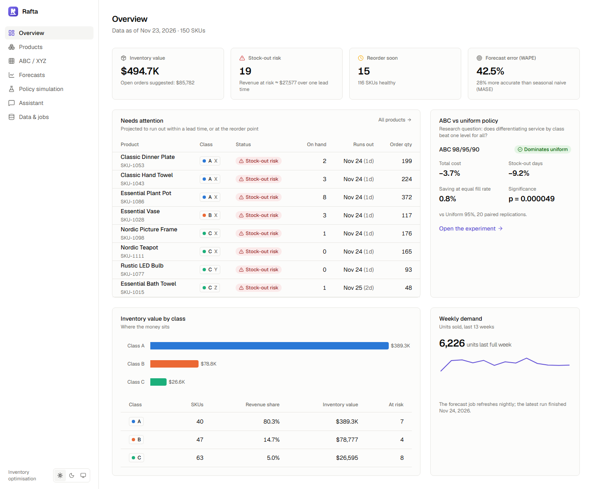
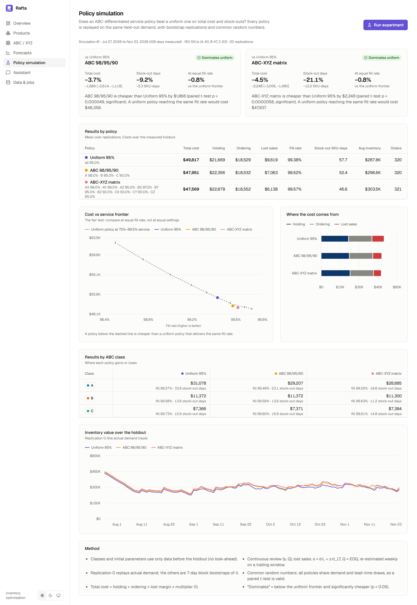
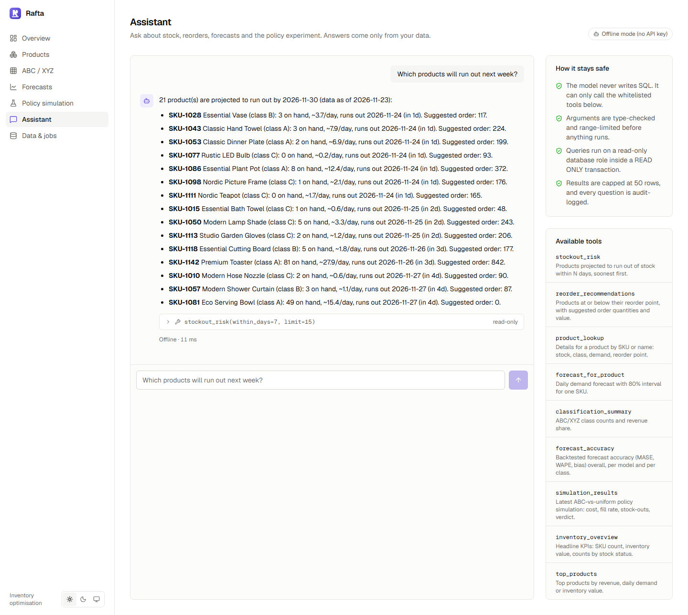
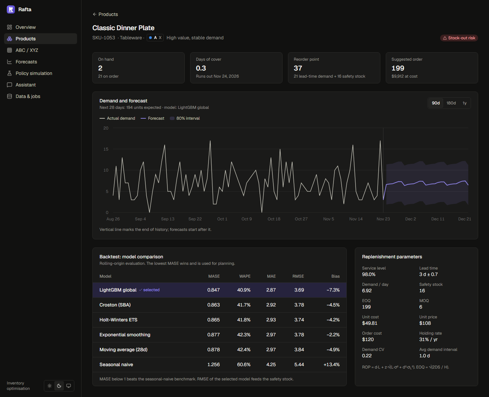
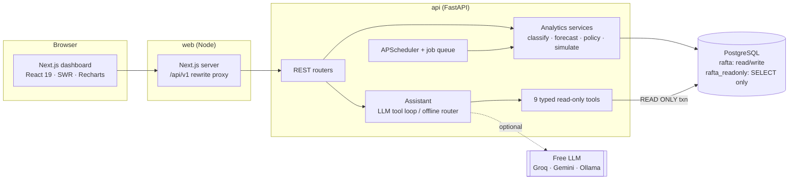

<p align="center"></p>

<h1 align="center">Rafta</h1>

<p align="center"><em>Rafta</em> is Turkish for "on the shelf".</p>

<p align="center"><a href="https://rafta-five.vercel.app"><b>▶ Live demo</b></a> &nbsp;·&nbsp; <a href="https://rafta-api.onrender.com/docs">API docs</a> &nbsp;·&nbsp; <a href="docs/METHODOLOGY.md">Methodology</a></p>

<p align="center"><sub>The demo API runs on a free tier that sleeps when idle, so the first load can take up to a minute.</sub></p>

**AI inventory optimisation for small and medium-sized retailers.** Rafta imports sales and stock CSVs, classifies every SKU (ABC/XYZ), backtests six forecasting models, sets safety stock, reorder points and order quantities, and runs a simulation experiment to answer one research question:

> **Does an ABC-differentiated service policy beat a uniform policy on total cost and stock-outs?**

It also has an AI assistant you can ask *"Which products will run out next week?"*. The assistant answers through read-only, type-checked tool calls, never through generated SQL.

[](https://github.com/taosiq/rafta/actions/workflows/ci.yml)    

---

## Screenshots

| Overview | Policy simulation |
|---|---|
|  |  |
| **AI assistant** | **Product detail (dark mode)** |
|  |  |

## Headline result

On the bundled 150-SKU dataset, with a 120-day holdout and 30 paired bootstrap replications using common random numbers:

| Policy | Total cost | Fill rate | Stock-out SKU-days |
|---|---:|---:|---:|
| Uniform 95% | 45,331 | 99.32% | 63.6 |
| ABC 98 / 95 / 90 | 44,285 | 99.44% | 54.9 |
| ABC-XYZ matrix | **44,038** | **99.50%** | **47.2** |

| Candidate vs Uniform 95% | Cost difference (95% CI) | p | Stock-out days |
|---|---|---:|---:|
| ABC 98/95/90 | −1,046 [−1,472, −621] | 2.3×10⁻⁵ | −13.7% |
| ABC-XYZ matrix | −1,293 [−1,800, −785] | 1.4×10⁻⁵ | −25.7% |

Both differentiated policies are cheaper **and** have fewer stock-outs, and the difference is statistically significant. The stricter test compares each policy with a uniform policy that delivers the *same* fill rate (the cost-vs-service frontier). Against that test the saving shrinks to 0.3–0.7%: most of the gain comes from 95% being a poor uniform setting, not from differentiation itself. [docs/METHODOLOGY.md](docs/METHODOLOGY.md) explains why that distinction matters. Reproduce the result with `python -m app.cli experiment`.

## Features

| | |
|---|---|
| **CSV import** | Products, daily sales and stock snapshots. Validation is atomic and row-level ("row 14: invalid date"), and re-imports are idempotent. Downloadable templates. |
| **ABC/XYZ classification** | Pareto by 12-month revenue, and coefficient of variation on complete weeks. Shown as a 3×3 matrix with policy guidance per cell. |
| **Forecasting** | Seasonal naive, moving average, SES, Holt-Winters ETS, Croston-SBA (for intermittent demand) and a global LightGBM model. Rolling-origin backtesting (MASE, WAPE, RMSE, bias). The best model is selected per SKU, with 80% intervals. |
| **Inventory policy** | Safety stock from backtested forecast error and lead-time variability, reorder point, EOQ with MOQ, projected stock-out date, suggested order, and status: risk / reorder / healthy. |
| **Simulation engine** | Vectorised (s, Q) lost-sales simulator with no look-ahead, block bootstrap, common random numbers, paired t-tests and the uniform efficient frontier. 20 replications × 13 policies × 150 SKUs runs in a few seconds. |
| **Background jobs** | Nightly forecast refresh (APScheduler cron), a job history table, and a PostgreSQL advisory lock so replicas never run the same job twice. |
| **AI assistant** | Works with any OpenAI-compatible LLM (Groq, Gemini or Ollama, all free). It can call 9 whitelisted tools, which run on a read-only DB role inside READ ONLY transactions, with result caps and an audit log. It falls back to an offline mode when no key is set. |
| **Dashboard** | Next.js 16 + TypeScript. Dark mode with no flash on load, colour only where it means something, accessible status badges, tabular numbers. |
| **Quality** | 79 backend tests (87% coverage, 96–99% on the analytics core), frontend unit tests, ruff, ESLint, tsc, Alembic migration drift check, CI on every push. |

## Architecture



More detail, including the data model and request flow: [docs/ARCHITECTURE.md](docs/ARCHITECTURE.md).

## Quick start

**With Docker** (recommended):

```bash
cp .env.example .env        # optional: add a free Groq/Gemini key for the LLM assistant
docker compose up --build   # then open http://localhost:3000
```

On first boot the API applies migrations, loads the demo dataset and runs the full pipeline (about 40 s). Refresh the dashboard once the job shows **success** on the *Data & jobs* page.

**Without Docker** (SQLite, no database server needed):

```bash
# API
cd api
python -m venv .venv && .venv/Scripts/activate      # macOS/Linux: source .venv/bin/activate
pip install -r requirements.lock pytest pytest-cov ruff
python -m app.cli seed                                # demo data + full pipeline
uvicorn app.main:app --reload                         # http://localhost:8000/docs

# Web (second terminal)
cd web
npm install
npm run dev                                           # http://localhost:3000
```

## Useful commands

| Command | What it does |
|---|---|
| `python -m app.cli experiment --replications 30 --out results.md` | Runs the thesis experiment and writes a Markdown results table |
| `python -m app.cli pipeline` | Classify → forecast → policies → simulate |
| `python -m app.cli export-sample ../data/sample` | Writes the demo dataset as CSVs, to try the import flow |
| `pytest --cov=app` | Backend tests with coverage |
| `npm run lint && npm run typecheck && npm test` | Frontend checks |

## Tech stack, all free and open source

| Layer | Choice | Why |
|---|---|---|
| Frontend | Next.js 16, React 19, TypeScript, Tailwind CSS 4, SWR, Recharts, lucide | App Router with partial prerendering; the API proxy keeps the browser same-origin |
| Backend | FastAPI, Pydantic 2, SQLAlchemy 2, Alembic | Typed request validation, portable ORM, versioned migrations |
| Analytics | pandas, NumPy, SciPy, statsmodels, LightGBM | Standard, well-understood forecasting and statistics tools |
| Jobs | APScheduler + thread pool + Postgres advisory lock | No Redis or Celery needed at SME scale; easy to swap later |
| AI | Any OpenAI-compatible endpoint: Groq / Gemini free tiers, or Ollama locally | No vendor lock-in, zero cost, and it works offline too |
| Database | PostgreSQL 17 (SQLite for dev and tests) | Read-only role for the assistant |
| Ops | Docker Compose, GitHub Actions, Dependabot | One-command run, CI on every push |
| Hosting (optional) | Vercel (web) + Render (API) + Neon (Postgres) free tiers | See [docs/DEPLOYMENT.md](docs/DEPLOYMENT.md) |

## Repository layout

```
api/                 FastAPI service
  app/services/      classification, forecasting, inventory, simulation, ingest, synthetic data
  app/assistant/     tool definitions + LLM loop + offline router
  app/routers/       REST endpoints (OpenAPI docs at /docs)
  app/jobs.py        job queue, advisory lock, nightly scheduler
  alembic/           migrations
  tests/             79 tests: unit, property-style, API, assistant safety
web/                 Next.js dashboard
  src/app/           pages: overview, products, ABC/XYZ, forecasts, simulation, assistant, data
  src/components/    UI kit, charts, app shell
db/init/             read-only role for the assistant
docs/                methodology, architecture, design system, deployment, experiment results
```

## License

MIT © 2026 Muhammad Taosiq Mehran. See [LICENSE](LICENSE).
