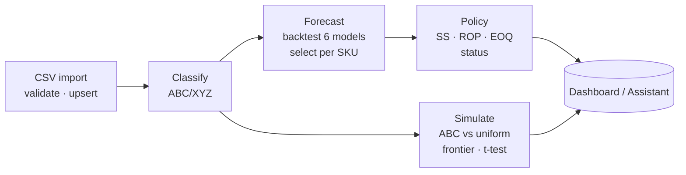
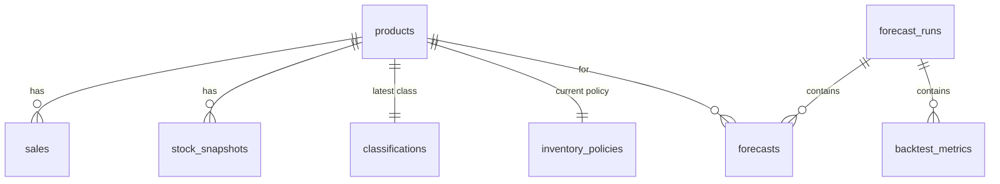

# Architecture

## Services

| Service | Tech | Responsibility |
|---|---|---|
| `web` | Next.js 16 (App Router, standalone output) | The dashboard UI. It proxies `/api/v1/*` to the API, so the browser stays same-origin and needs no CORS. |
| `api` | FastAPI on Uvicorn | REST API, analytics engine, background jobs, nightly scheduler, assistant |
| `db` | PostgreSQL 17 | System of record. Role `rafta` (read/write) and role `rafta_readonly` (SELECT only, read-only by default, 5 s statement timeout) |

## Pipeline



The nightly job (`refresh`: classify → forecast → policy) runs on an APScheduler cron (`FORECAST_CRON`, default `0 2 * * *` UTC). The `pipeline` job also runs the simulation.

## Data model



* `simulation_runs`, `job_runs` and `assistant_logs` are standalone tables (results are stored as JSON).
* Forecast and simulation runs are **versioned**: every run is kept, which makes thesis results reproducible.
* `classifications` and `inventory_policies` hold the *current* state and are overwritten on each run.
* `assistant_logs` is the audit trail: the question, which tools ran, the mode and the latency.

## Background jobs

* `POST /api/v1/jobs` creates a `job_runs` row (`queued`) and submits it to a **single-worker** thread pool, so jobs never overlap inside one process.
* Each job takes `pg_try_advisory_lock`, so two API replicas never run the pipeline concurrently.
* Each step commits on its own, and the status and message are written back for the UI to poll.
* Scaling path: the step functions are plain callables `(Session, params) -> str`, so moving them to Arq, RQ or Celery workers is a mechanical change.

## Assistant safety

```mermaid
sequenceDiagram
  participant U as User
  participant A as API /assistant/ask
  participant L as LLM (Groq/Gemini/Ollama)
  participant T as Tool registry
  participant DB as Postgres (rafta_readonly)
  U->>A: "Which products will run out next week?"
  A->>L: system prompt + question + 9 tool schemas
  L-->>A: tool_call stockout_risk {within_days: 7}
  A->>T: validate args (Pydantic: types, enums, ranges)
  T->>DB: SET TRANSACTION READ ONLY; SELECT ... LIMIT ≤ 50
  DB-->>T: rows
  T-->>A: JSON (truncated to 6 KB)
  A->>L: tool result
  L-->>A: final answer
  A-->>U: answer + tool trace (shown in UI) + audit log
```

| Layer | Control |
|---|---|
| Capability | No SQL generation. Only 9 named functions exist. Unknown tools are rejected with an error the model can read. |
| Input | Pydantic schemas: enums for classes and metrics, ranges for days and limits, 64-character string caps. The question itself is capped at 500 characters. |
| Database | Separate connection as `rafta_readonly` (SELECT-only grants, `default_transaction_read_only = on`, 5 s timeout), plus `SET TRANSACTION READ ONLY`, plus rollback after every call |
| Output | ≤ 50 rows per tool, tool results truncated to 6 KB before reaching the model, at most 4 tool rounds |
| Prompt injection | The system prompt marks tool results as data, not instructions. Tools return structured JSON rather than free text. |
| Availability | An LLM error or timeout falls back to a deterministic offline router that uses the same tools |
| Audit | Every question, tool call, mode and latency is stored in `assistant_logs` |

## API surface

The interactive OpenAPI documentation is at `http://localhost:8000/docs`. Main routes:

| Method | Path | Purpose |
|---|---|---|
| GET | `/api/v1/overview` | KPIs, at-risk list, class split, latest results |
| GET | `/api/v1/products` | Filter, sort and paginate |
| GET | `/api/v1/products/{sku}` | History, forecast, backtest and parameters |
| GET | `/api/v1/classification` | Items, matrix, Pareto curve |
| GET | `/api/v1/forecasts/summary` | Accuracy per model, class and XYZ |
| GET/POST | `/api/v1/simulations` | List runs, or run a custom experiment |
| POST | `/api/v1/imports/{products\|sales\|stock}` | CSV upload |
| POST | `/api/v1/jobs` | Start `classify`, `forecast`, `policy`, `simulate`, `refresh` or `pipeline` |
| POST | `/api/v1/assistant/ask` | Ask a question |
| POST | `/api/v1/demo/seed` | Load the demo dataset and run the pipeline |
